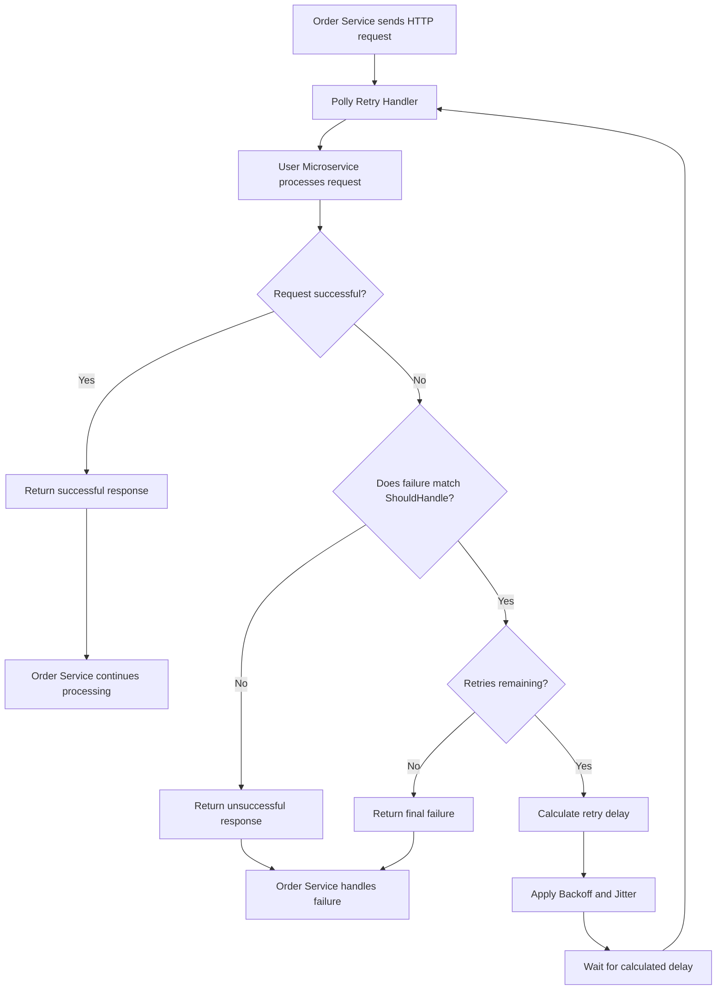

# Fault Tolerance – Retry Pattern Using Polly v8

## 1. What is Fault Tolerance?

Fault Tolerance is the ability of an application to continue operating even when one or more components fail.

In a microservices architecture, services communicate over a network. Temporary failures can occur due to:

- Network interruptions.
- Service unavailability.
- Request timeouts.
- Server errors (HTTP 5xx).

Fault tolerance techniques help applications handle these failures gracefully.

## 2. What is the Retry Pattern?

Retry is a fault tolerance technique in which an application automatically retries an operation when it encounters a temporary failure.

**Example:**

Our Order Microservice calls User Microservice to retrieve user details.

1. Order Service sends a request to User Service.
2. User Service temporarily fails.
3. Order Service waits for a configured delay.
4. Order Service retries the request.
5. If the request succeeds, processing continues.


### When should we use Retry?

Retry is useful for temporary failures, such as:

- HTTP 408 – Request Timeout.
- HTTP 429 – Too Many Requests.
- HTTP 500 – Internal Server Error.
- HTTP 502 – Bad Gateway.
- HTTP 503 – Service Unavailable.
- HTTP 504 – Gateway Timeout.

We should generally avoid retrying permanent failures such as HTTP 400, 401 and 404.

---

## 3. What is Polly?

[Polly](https://www.pollydocs.org/) is a .NET resilience and transient-fault-handling library.

It provides resilience strategies that help .NET applications handle failures when communicating with external services.

Polly v8 introduced the concept of **Resilience Pipelines**.

A Resilience Pipeline executes operations using configured resilience strategies.

For Retry, Polly v8 provides:

| Component | Purpose |
|---|---|
| `ResiliencePipelineBuilder` | Creates and configures a pipeline. |
| `RetryStrategyOptions` | Configures Retry behavior. |
| `AddRetry()` | Adds Retry to the pipeline. |
| `Build()` | Builds the configured pipeline. |
| `ExecuteAsync()` | Executes an operation through the pipeline. |
| `AddResilienceHandler()` | Integrates resilience into HttpClient. |

---

## 4. Important Retry Properties

| Property | Description |
|---|---|
| `MaxRetryAttempts` | Maximum number of retries after the original request. |
| `Delay` | Initial/base delay used to calculate retry delays. |
| `BackoffType` | Determines how retry delays are calculated. |
| `UseJitter` | Adds randomness to retry delays. |
| `ShouldHandle` | Defines which failures should trigger retries. |

### A. MaxRetryAttempts

```csharp
MaxRetryAttempts = 3
```

This means three retries after the original request.

Maximum executions = 4.

### B. Delay

```csharp
Delay = TimeSpan.FromSeconds(2)
```

Defines the initial/base delay used by the Retry strategy.

### C. BackoffType

Defines how the delay changes between retries.

**Constant Backoff:** Delay remains the same.

```text
2s → 2s → 2s
```

**Linear Backoff:** Delay increases linearly.

```text
2s → 4s → 6s
```

**Exponential Backoff:** Delay increases exponentially.

```text
2s → 4s → 8s
```

These are illustrative delays without jitter.

### D. UseJitter

```csharp
UseJitter = true
```

Jitter introduces randomness into retry delays.

**Why do we need Jitter?**

Consider a scenario where 1,000 Order Service instances are communicating with User Service.

Suppose User Service suddenly becomes unavailable.

Without Jitter:

- All instances fail.
- All instances wait for approximately the same duration.
- All instances retry at approximately the same time.
- User Service receives another large burst of requests.

This can create additional load on an already struggling service.

With Jitter:

- Each request gets a randomized retry delay.
- Retry requests become distributed over time.
- All instances are less likely to retry simultaneously.

This helps reduce the **Thundering Herd Problem**.

**Practical Jitter Example:**

Consider Polly v8 with:

```csharp
Delay = TimeSpan.FromSeconds(1),
BackoffType = DelayBackoffType.Exponential,
UseJitter = true
```

For comparison, here are example delay sequences documented by Polly:

| Retry | Without Jitter | With Jitter (example) |
|---|---:|---:|
| Retry 1 | 1,000 ms | 393 ms |
| Retry 2 | 2,000 ms | 1,453 ms |
| Retry 3 | 4,000 ms | 4,235 ms |
| Retry 4 | 8,000 ms | 5,369 ms |
| Retry 5 | 16,000 ms | 16,849 ms |

**Important:**

- These are illustrative sample values, not guaranteed delays.
- Without Jitter, exponential backoff follows a predictable progression.
- With Jitter, Polly v8 uses Decorrelated Jitter Backoff V2 for exponential backoff.
- The actual delays can vary between executions and may not always increase.

**Remember:**

Exponential Backoff controls how retry delays progress, while Jitter helps distribute retry attempts over time.

---

# 5. Implementing Retry Using Polly v8

Our example:

- Order Microservice communicates with User Microservice.
- We use a typed `HttpClient`.
- Polly automatically retries failed HTTP requests.

### Step 1: Install NuGet package

Install the following package in the OrderMicroserviceAPI project:

```powershell
Install-Package Microsoft.Extensions.Http.Resilience
```

### Step 2: Create the interface

`IUserMicroservicePolicies.cs`

```csharp
using Polly;

namespace BusinessLogicLayer.Policies
{
    public interface IUserMicroservicePolicies
    {
        void ConfigureRetry(
            ResiliencePipelineBuilder<HttpResponseMessage> pipeline);
    }
}
```

The interface defines the contract for configuring the User Microservice Retry pipeline.

### Step 3: Implement the Retry configuration

`UserMicroservicePolicies.cs`

```csharp
using Polly;
using Polly.Retry;
using System.Net;

namespace BusinessLogicLayer.Policies
{
    public class UserMicroservicePolicies : IUserMicroservicePolicies
    {
        public void ConfigureRetry(
            ResiliencePipelineBuilder<HttpResponseMessage> pipeline)
        {
            pipeline.AddRetry(new RetryStrategyOptions<HttpResponseMessage>
            {
                MaxRetryAttempts = 3,
                Delay = TimeSpan.FromSeconds(2),
                UseJitter = true,
                BackoffType = DelayBackoffType.Exponential,

                ShouldHandle = new PredicateBuilder<HttpResponseMessage>()
                    .Handle<HttpRequestException>()
                    .HandleResult(response =>
                        response.StatusCode == HttpStatusCode.RequestTimeout ||
                        response.StatusCode == HttpStatusCode.TooManyRequests ||
                        (int)response.StatusCode >= 500)
            });
        }
    }
}
```

**Explanation:**

- `AddRetry()` adds the Retry strategy.
- `RetryStrategyOptions<HttpResponseMessage>` configures Retry for HTTP responses.
- `MaxRetryAttempts = 3` allows three retries.
- `Delay = 2 seconds` sets the initial/base delay.
- `BackoffType.Exponential` increases the delay exponentially.
- `UseJitter = true` randomizes retry delays.
- `ShouldHandle` specifies which HTTP failures trigger retries.

### Step 4: Register in Program.cs

Add the namespace:

```csharp
using BusinessLogicLayer.Policies;
```

Register the interface and implementation:

```csharp
builder.Services.AddSingleton<
    IUserMicroservicePolicies,
    UserMicroservicePolicies>();
```

Register the typed HttpClient and attach Polly:

```csharp
builder.Services.AddHttpClient<UserServiceClient>(client =>
{
    client.BaseAddress = new Uri(
        builder.Configuration["UserService:BaseUrl"]
        ?? "https://localhost:7061");
})
.AddResilienceHandler("UserServiceRetry", (pipeline, context) =>
{
    var policies = context.ServiceProvider
        .GetRequiredService<IUserMicroservicePolicies>();

    policies.ConfigureRetry(pipeline);
});
```

**What happens here?**

1. `AddHttpClient()` registers a typed HTTP client.
2. `AddResilienceHandler()` attaches Polly to the outgoing HTTP pipeline.
3. `context.ServiceProvider` accesses the DI container.
4. `GetRequiredService()` retrieves the registered policy implementation.
5. `ConfigureRetry(pipeline)` adds our Retry strategy to the HTTP pipeline.

### Step 5: UserServiceClient

Our existing HTTP request remains simple:

```csharp
var response = await _httpClient.GetAsync(
    $"api/auth/getUser/{userId}");
```

We do not need to call `ExecuteAsync()` manually.

The Polly handler automatically applies Retry to outgoing requests made through this configured HttpClient.

---

# 6. Alternative: Configure Retry Directly in Program.cs

If we don't want separate interface and implementation classes, we can configure Retry directly inside `Program.cs`.

```csharp
builder.Services.AddHttpClient<UserServiceClient>(client =>
{
    client.BaseAddress = new Uri(
        builder.Configuration["UserService:BaseUrl"]
        ?? "https://localhost:7061");
})
.AddResilienceHandler("UserServiceRetry", pipeline =>
{
    pipeline.AddRetry(new RetryStrategyOptions<HttpResponseMessage>
    {
        MaxRetryAttempts = 3,
        Delay = TimeSpan.FromSeconds(2),
        UseJitter = true,
        BackoffType = DelayBackoffType.Exponential,

        ShouldHandle = new PredicateBuilder<HttpResponseMessage>()
            .Handle<HttpRequestException>()
            .HandleResult(response =>
                response.StatusCode == HttpStatusCode.RequestTimeout ||
                response.StatusCode == HttpStatusCode.TooManyRequests ||
                (int)response.StatusCode >= 500)
    });
});
```

This approach keeps the Retry configuration directly inside `Program.cs`.

**Difference between the two approaches:**

| Interface + Implementation | Direct Program.cs |
|---|---|
| Separates policy configuration. | Configuration is inside Program.cs. |
| Easier to reuse across clients. | Convenient for simpler applications. |
| Better separation of responsibilities. | Less code and fewer classes. |
| Requires interface and implementation. | No separate policy classes required. |

Both approaches use Polly v8. Choose one approach for a given HTTP client rather than registering duplicate Retry handlers.

---

# 7. Retry Policy – Execution Flow Diagram

The following diagram explains how Polly decides whether to retry an HTTP request.



### Understanding the diagram

1. Order Service sends an HTTP request.
2. Polly intercepts the outgoing request through the resilience handler.
3. User Microservice processes the request.
4. Polly evaluates the response.
5. If the response is successful, it returns immediately.
6. If unsuccessful, Polly checks the `ShouldHandle` condition.
7. If the failure is not retryable, it returns the response without retrying.
8. If the failure is retryable, Polly checks the remaining retry attempts.
9. If retries remain, Polly calculates the delay using Backoff and Jitter.
10. Polly waits and executes the request again.
11. If all retries are exhausted, the final failure is returned to Order Service.

---

# 8. How Does the HTTP Request Pipeline Work?

Our architecture:

```text
Client
   |
   v
Order Microservice
   |
   v
UserServiceClient
   |
   v
HttpClient
   |
   v
Polly Resilience Handler
   |
   v
Retry Strategy
   |
   v
User Microservice
```

If User Microservice returns a handled failure:

```text
HTTP Request
     |
     v
Temporary Failure
     |
     v
Polly checks ShouldHandle
     |
     v
Calculate Backoff + Jitter
     |
     v
Wait
     |
     v
Retry Request
     |
     v
Success or Final Failure
```

---

# 9. Important Production Considerations

1. **Selective Retry:** Retry only transient failures, not every HTTP error.
2. **Timeout:** Configure appropriate request timeouts.
3. **Logging:** Record retry attempts and failures.
4. **Idempotency:** Protect operations such as order creation against duplicate execution.
5. **Testing:** Test successful requests, retryable failures and exhausted retries.

Note: HTTP GET requests are generally safe to retry. Be careful when retrying POST requests that create or modify data.

---

# 10. Interview Questions

**Q1. What is the Retry Pattern?**

Retry automatically executes an operation again when a temporary failure occurs.

**Q2. What is Polly?**

Polly is a .NET resilience library used to handle transient failures using strategies such as Retry.

**Q3. What is Exponential Backoff?**

It progressively increases the delay between retries, for example 2, 4 and 8 seconds when jitter is disabled.

**Q4. Why do we use Jitter?**

Jitter randomizes retry delays to prevent multiple instances from retrying simultaneously.

**Q5. What is MaxRetryAttempts = 3?**

It means three retries after the original execution, giving a maximum of four executions.

**Q6. What is AddResilienceHandler()?**

It integrates Polly resilience strategies into the outgoing HTTP request pipeline of HttpClient.

**Q7. Why use an interface for policy configuration?**

It separates the policy contract from its implementation, improving maintainability and testability.

**Q8. Should we retry every HTTP error?**

No. Retry should generally handle temporary failures such as HTTP 408, 429 and 5xx errors.

**Q9. What is the Thundering Herd Problem?**

It occurs when many clients retry requests simultaneously, potentially overwhelming a recovering service.

**Q10. Why should we be careful when retrying POST requests?**

Because the original request might have succeeded even if its response was lost. Retrying can create duplicate operations unless idempotency is handled.

---

# 11. Quick Revision

- Fault Tolerance helps applications handle failures.
- Retry automatically repeats an operation after a handled failure.
- Polly is a .NET resilience library.
- Polly v8 uses `ResiliencePipeline`.
- `AddRetry()` adds the Retry strategy.
- `MaxRetryAttempts` controls the number of retries.
- `Delay` defines the base delay.
- `BackoffType` determines how delays increase.
- `UseJitter` randomizes retry delays.
- `AddResilienceHandler()` integrates Polly with HttpClient.
- `ShouldHandle` determines which failures trigger retries.

**Key takeaway:** Retry improves the reliability of microservices communication by automatically recovering from temporary failures instead of immediately failing the operation.

### Official References

- [Polly v8 – Retry Strategy Documentation](https://www.pollydocs.org/strategies/retry)
- [Polly – Retry Strategy Cheat Sheet](https://www.pollydocs.org/media/cheat-sheet-retry.pdf)
- [Polly – Jitter and Backoff Explanation](https://github.com/Polly-Contrib/Polly.Contrib.WaitAndRetry)
